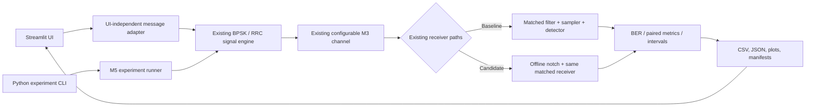
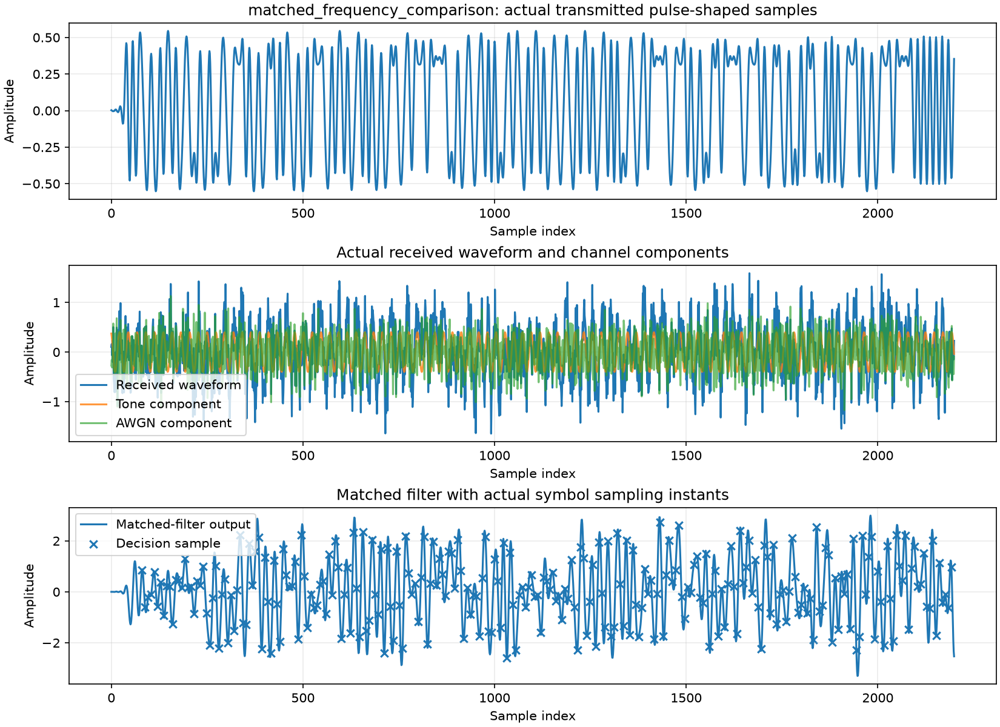
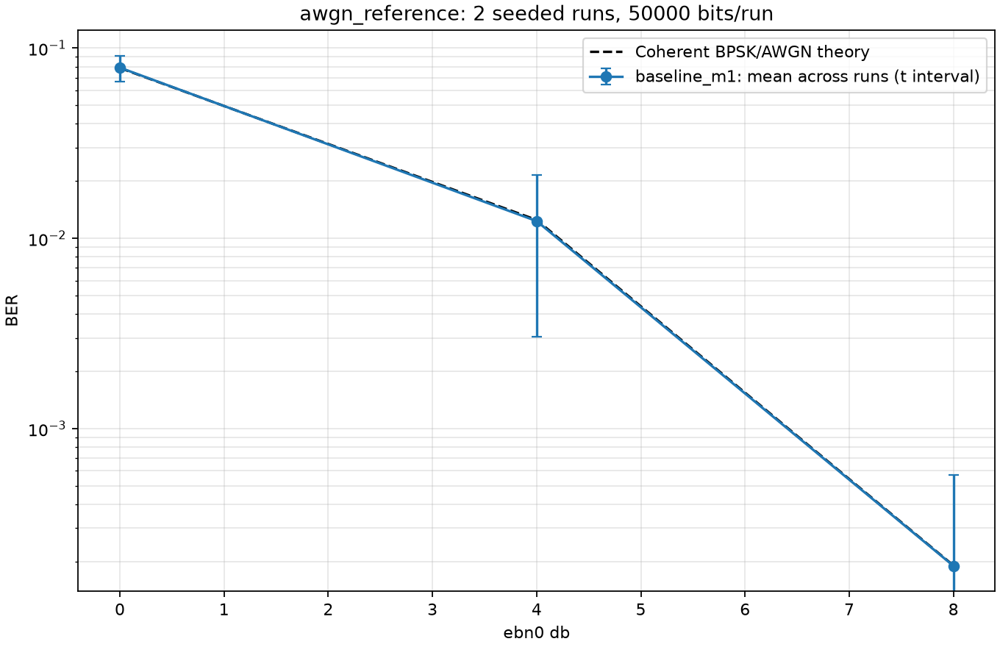

# SignalShield — Interactive Digital Communications Lab

**Transmit. Disturb. Recover. Analyze.**

SignalShield is a reproducible educational simulation of an uncoded real-baseband BPSK communication link. It combines a one-sample BPSK/AWGN reference, an oversampled RRC waveform and matched-filter path, configurable AWGN/tone/attenuation, an offline notch-receiver comparison, reproducible experiment tools, and a local interactive Streamlit application.

**Engineering question:** under which modeled channel conditions does the baseline or notch receiver recover more transmitted bits, and what signal-distortion or statistical limitations accompany that result?

This is a discrete-time simulation, not an RF/SDR model, standards-compliant modem, production anti-jamming product, or security system.

## Implemented capabilities

- M1: seeded BPSK/AWGN reference with coherent uncoded theory and exact BER intervals.
- M2: oversampled BPSK, finite unit-energy root-raised-cosine pulse shaping, matched filtering, and delay-aware sampling.
- M3: signal-only attenuation, optional real sinusoidal interference, and real AWGN with separately observable channel components.
- M4: baseline and configured second-order notch paths. The current `filtfilt` implementation is offline and noncausal.
- M5: validated experiment configurations, deterministic seed derivation, raw measurement records, exact binomial intervals, paired block bootstrap, summaries, plots, and replayable CLI runs.
- M6: UTF-8 text payload demonstration, actual waveform/channel/receiver visualizations, paired receiver comparison, local Performance Lab, integration tests, and final validation evidence.

## System architecture



The user interface and experiment runner orchestrate calls into the same reusable simulation engine. Neither contains a separate implementation of modulation, pulse shaping, channel processing, or receiver detection. See [System Architecture](docs/system_architecture.md) and [System Design](docs/system_design.md).

## Installation — Windows PowerShell

Python 3.11 or later is required. From the project root:

```powershell
python -m venv .venv
.\.venv\Scripts\python.exe -m pip install --upgrade pip
.\.venv\Scripts\python.exe -m pip install -e ".[dev,app]"
```

`pyproject.toml` defines the package, scientific dependencies, test extra, and Streamlit app extra. `requirements.txt` records the resolved environment used for M6 verification. To refresh existing package metadata after editing the project, repeat the editable install command.

## Run the application

```powershell
.\.venv\Scripts\python.exe -m streamlit run src\signalshield\streamlit_app.py
```

Open the local URL printed by Streamlit (normally `http://localhost:8501`). The app has three tabs: **Transmit & Analyze**, **Channel & Receiver Analysis**, and **Performance Lab**. The first tab supports UTF-8 text and short WAV/microphone audio payloads with framing, CRC-32, and optional Hamming (7,4). See the [User Guide](docs/user_guide.md) for audio limits and the full workflow.

## Public web deployment

The reviewed source is published at [github.com/AJC938/SignalShield](https://github.com/AJC938/SignalShield). SignalShield is prepared for [Streamlit Community Cloud](https://share.streamlit.io/) with a root `requirements.txt`, root `.streamlit/config.toml`, and the entry point `src/signalshield/streamlit_app.py`. Select Python 3.11 in the Community Cloud advanced settings to match the validated local runtime. The requested subdomain is `signalshield-lab`; Community Cloud will confirm whether it is available when the app is created. The public application URL will be added here after deployment and public access are verified.

To deploy the public repository:

1. Sign in to Streamlit Community Cloud and choose **Create app**.
2. Select the repository and `main` branch, then enter `src/signalshield/streamlit_app.py` as the app file.
3. In **Advanced settings**, select Python 3.11. No secrets are required.
4. Request `signalshield-lab` as the app subdomain if available, deploy, and set **Who can view this app** to public.

Interactive simulations are bounded; Performance Lab caps each run at 250,000 bits and each experiment at 1,000,000 total bit trials across sweep points and repetitions. Community Cloud's local disk is temporary, so use the app's CSV/JSON download buttons to keep experiment outputs. See [reports/deployment_report.md](reports/deployment_report.md) for the preparation, publishing, and verification status.

## Run tests

```powershell
.\.venv\Scripts\python.exe -m pytest -q
```

The M6 final verification command and result are recorded in [reports/M6_final_validation_report.md](reports/M6_final_validation_report.md). The application integration tests include a browserless Streamlit `AppTest` run; an HTTP health check was also made against a live local server.

## Run experiments

Run one M5 scenario, for example a repeatable AWGN reference sweep:

```powershell
.\.venv\Scripts\python.exe -m signalshield.experiment_runner --scenario awgn_reference --n-bits 50000 --repetitions 2 --seed 20261030 --ebn0-values 0 4 8 --output-dir results/m6/manual_awgn
```

The seven supported scenarios are `awgn_reference`, `waveform_awgn`, `interference_amplitude`, `interference_frequency`, `attenuation`, `receiver_comparison`, and `frequency_mismatch`. Replay from saved configuration with `--config path\to\resolved_config.json`. See `python -m signalshield.experiment_runner --help` for exact options. Standalone M1–M4 experiment commands remain available as documented in their respective sections below and reports.

The Performance Lab exposes scenario, bit count, repetition count, seed, and relevant sweep selection. Its results go to a unique application-managed folder under `results/m6/performance/`; the UI provides CSV/JSON downloads and displays saved plots. The default is 10,000 bits per repetition. Larger workloads require an explicit change in the UI.

Reproduce the M6 payload validations and long-run benchmark:

```powershell
.\.venv\Scripts\python.exe scripts\run_m6_validation.py --output-dir results/m6/validation --n-bits 50000 --repetitions 2 --seed 20261030
```

## Channel and receiver conventions

- BPSK uses `0 → +1`, `1 → −1`; the reference model uses one real sample per bit.
- The sampled waveform uses 8 samples/symbol, RRC rolloff 0.35 and span 10 by default. Full convolution preserves filter tails; the total Tx/Rx delay is compensated before symbol decisions.
- Real AWGN variance is `Eb/(2·10^(Eb/N0_dB/10))`. Turning AWGN off sets its variance to zero; it does not silently substitute another noise level.
- Attenuation applies only to the desired signal. Its voltage gain is `10^(-attenuation_dB/20)`. Tone and AWGN are added after attenuation.
- Tone frequency is expressed in cycles/symbol, peak amplitude in waveform units, and phase in radians.
- The notch center is explicitly configured; the receiver does not estimate unknown interference. `iirnotch` followed by forward/backward `filtfilt` is noncausal offline processing, not a real-time receiver.
- The payload screen reports coded-bit BER before FEC, post-FEC frame-bit errors separately, and CRC/exact-byte status. Short-payload BER is not a substitute for Monte Carlo BER. CRC is not authentication; Hamming (7,4) corrects one bit per codeword but cannot guarantee recovery from multiple errors.
- Audio accepts PCM signed 16-bit WAV, mono/stereo, 8–48 kHz, at most one second/2 MiB; it transmits normalized mono 8 kHz PCM samples with audio metadata protected in the frame. Audio is never transcribed.

## Verified findings

The M6 long-run M1 AWGN benchmark used 50,000 bits per run, two repetitions, seed `20261030`, and Eb/N0 points 0, 4, and 8 dB. Mean measured BERs were `0.07899`, `0.01233`, and `0.00019`; corresponding theoretical values were approximately `0.07865`, `0.01250`, and `0.000191`. The measurements are consistent with the coherent BPSK/AWGN reference at this sample size.

In a paired M6 message run with a 0.35 cycles/symbol tone, 0.40 peak amplitude, 6 dB Eb/N0, and 1,752 payload bits, baseline BER was `0.14555` and notch BER `0.006279` (paired delta `−0.13927`). For a mismatch with actual tone 0.60 and notch center 0.35 cycles/symbol, baseline BER was `0.01142` and notch BER `0.01655` (delta `+0.005137`). These are finite short-payload outcomes, not general performance guarantees or statistical significance claims. M5 contains longer controlled receiver comparisons and their uncertainty analysis.

## Results and figures

- Final report and acceptance matrix: [M6 final validation report](reports/M6_final_validation_report.md).
- M6 end-to-end results: `results/m6/validation/` (message JSON summaries, raw traces, PNG diagnostics, M5 CSV/JSON/plots, and replay comparison).
- M5 seven-scenario suite: `results/m5/`.
- Historical milestone reports: `reports/M1_engineering_report.md` through `reports/M5_engineering_report.md`.

Example figures generated from the actual M6 matched-tone simulation arrays:





## Known limitations

- The RRC pulse is finite and truncated, so small residual symbol-spaced ISI remains; it is not described as exactly zero.
- There is no synchronization, fading, equalization, RF front end, or real-time DSP. The payload UI's optional Hamming code is limited to single-bit-per-codeword correction and is not part of the M1–M6 benchmark models.
- The notch is frequency-specific, can distort wanted signal energy, and is noncausal in this implementation.
- Short payloads have coarse BER resolution. Per-run binomial intervals assume Bernoulli trials; waveform filtering may introduce error dependence. Recorded two-repeat summaries remain exploratory.
- Simulation units are normalized discrete-time samples and are not calibrated to a physical channel or ADC.
- No license file is included. The project owner must choose a license before public distribution; none has been invented or selected here.

## Project documents

- [User Guide](docs/user_guide.md)
- [System Architecture](docs/system_architecture.md)
- [System and Mathematical Design](docs/system_design.md)
- [Validation and Experiments](docs/validation_and_experiments.md)
- [Implementation Plan](docs/implementation_plan.md)
- [Codex Handoff](docs/codex_handoff.md)
- [M6 Final Validation Report](reports/M6_final_validation_report.md)
- [Payload UI Refinement Report](reports/payload_ui_refinement_report.md)
- [Final UI/UX Refinement Report](reports/ui_refinement_report.md)
- [Deployment Report](reports/deployment_report.md)
- [Portfolio Summary](docs/portfolio_summary.md)
