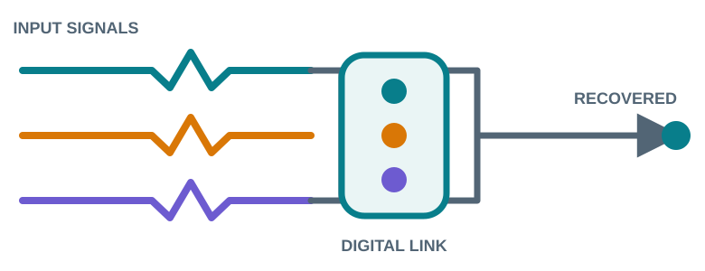

  
  <h1>SignalShield</h1>
  
<strong>Interactive Digital Communications Lab</strong>

  
Transmit · Disturb · Recover · Analyze

  <!-- The verified free-hosted app link will be placed here after Streamlit deployment. -->
  <strong>Live app link is being prepared.</strong>

SignalShield is an educational digital communications simulator. It lets you send short text or audio payloads through a configurable BPSK link, inspect channel effects, and compare receiver outputs in a visual web interface.

## Signal system

  

The interface follows **Input → Signal System → Output**, with waveform and integrity analysis underneath.

## Capabilities

- UTF-8 text and short PCM WAV audio payloads with framing, CRC-32, and optional Hamming (7,4) error correction.
- Pulse-shaped BPSK transmission with root-raised-cosine filtering and matched-filter reception.
- Configurable AWGN, narrowband tone interference, signal attenuation, and baseline/notch receiver comparison.
- Actual transmit, channel, receiver, and recovery visualizations; the displayed output comes from the decoded receiver payload.
- A separate Performance Lab for bounded, repeatable experiments with downloadable result files.

## Technology

Python 3.11+, Streamlit, NumPy, SciPy, and Matplotlib. No API keys or external services are required by the simulator.

## Public web app

The application is being prepared for the free Streamlit Community Cloud. Its hosted address will use a `streamlit.app` subdomain; `signalshield-lab` is the requested name, subject to availability. The final HTTPS link will replace the message above after deployment and public access are verified. A custom `.dev` domain would need to be registered separately.

## Educational scope

This is a normalized discrete-time simulation, not an RF/SDR model, production modem, real-time receiver, or security product. CRC checks accidental corruption and is not authentication. Short-message BER is not a long-run performance estimate.

## Project documents

- [User Guide](docs/user_guide.md)
- [System Architecture](docs/system_architecture.md)
- [System and Mathematical Design](docs/system_design.md)
- [Validation and Experiments](docs/validation_and_experiments.md)
- [Deployment Status](reports/deployment_report.md)
- [M6 Final Validation Report](reports/M6_final_validation_report.md)
- [UI Refinement Report](reports/ui_refinement_report.md)
