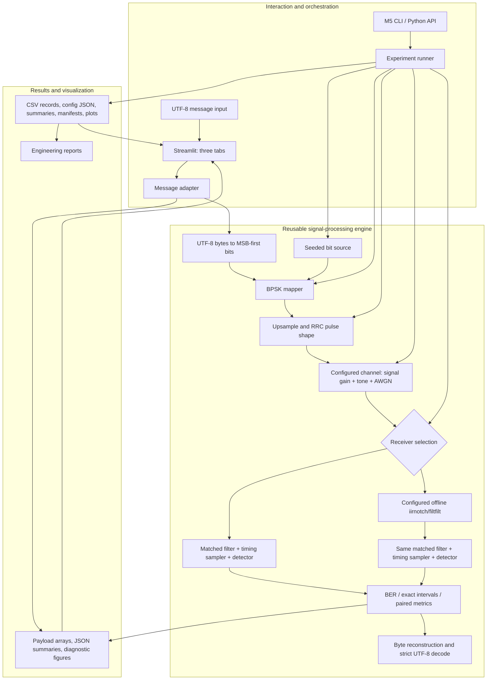

# SignalShield System Architecture

## Layer boundaries

The numerical engine remains independent of Streamlit. The UI-facing adapter handles message serialization and user-oriented result packaging but delegates all modulation, waveform generation, channel operations, detection, and BER calculations to the established package modules. The experiment runner is a second orchestration client of the same engine and owns long-run records, aggregation, and reproducible output files.

## Core responsibilities

| Component | Responsibility | Established implementation |
|---|---|---|
| Source and mapping | Explicit RNG bit generation and `{0,1}` BPSK mapping | `signals.py`, `modulation.py` |
| Waveform | Upsampling, finite unit-energy RRC taps, full convolution | `waveform.py`, `filters.py` |
| Channel | Signal-only attenuation, optional sinusoid, real AWGN, same-length component arrays | `channel.py` |
| Receiver | Matched filtering, total-delay compensation, symbol decisions | `receiver.py` |
| Candidate receiver | Configured second-order notch, then unchanged matched receiver | `notch.py`, `m4_experiments.py` |
| Metrics | BER from actual arrays, exact binomial interval, BPSK theory, paired block bootstrap | `metrics.py` |
| Payload adapter | UTF-8 byte/bit conversion, engine calls, decoding status, pair diagnostics | `application.py` |
| Experiment orchestration | Config validation, stable seed derivation, repeated scenarios, records, artifacts | `experiment_framework.py`, `experiment_runner.py` |
| Interactive UI | Forms/tabs, output display, plots from result arrays, downloads | `streamlit_app.py` |
| Final verification | Repeatable representative cases, plots, validation output index | `scripts/run_m6_validation.py` |

## Message data path

1. The UI collects message and validated channel/receiver settings.
2. `application.encode_message` encodes UTF-8 and unpacks bytes MSB-first.
3. Existing `bpsk_modulate`, `rrc_taps`, and `pulse_shape` create symbols and the transmit waveform.
4. Existing `apply_configured_channel` returns received samples and actual wanted-signal, tone, and noise arrays.
5. The baseline calls the M2 matched receiver. The notch path filters the same received array and then calls that same M2 receiver.
6. BER is computed by existing `ber_estimate` from transmitted and detected bits. Strict UTF-8 decoding reports errors rather than inserting replacement text.
7. UI charts use those arrays and actual symbol indices. Performance Lab calls the same M5 runner as the command line.

## Mathematical and execution contracts

- BPSK mapping is `0 → +1`, `1 → −1`; real AWGN variance is `Eb/(2·10^(Eb/N0_dB/10))`.
- RRC uses finite odd length `span_symbols*samples_per_symbol+1`, unit tap energy, and total Tx/Rx group delay `span_symbols*samples_per_symbol` samples.
- M3 channel is `r[n] = g*s[n] + i[n] + w[n]`; attenuation applies to the desired signal only. Tone frequency is cycles/symbol, rendered at discrete frequency `f_sym/sps` cycles/sample.
- Notch center is supplied/configured, not estimated. `filtfilt` is noncausal/offline.
- Text payload BER is a finite short sample. The Performance Lab and M5 CLI are used for long-run estimates.
- Config and seeds are explicit. Execution time is nondeterministic metadata and excluded from exact reproduction comparisons.

## Output boundaries

Payload UI results are stored in Streamlit session state until settings change; the output display suppresses stale message results. The Performance Lab creates unique folders under `results/m6/performance/`. The reproducible M6 validation script writes fixed, documented artifacts under `results/m6/validation/`: JSON/CSV summaries, trace arrays, plots, M5 run outputs, replay outputs, and a manifest.
