# SignalShield System Design and Mathematical Specification

## 1. Executive technical overview

SignalShield is a reproducible Python simulator for a binary digital communication link. Its primary question is: **under which channel impairments and receiver assumptions can a receiver recover more transmitted information, and what costs or failure modes accompany that improvement?**

The project establishes a coherent BPSK/AWGN reference, extends it to a finite, oversampled pulse-shaped baseband link, adds controlled sinusoidal interference and gain, and compares a baseline matched-filter/detector with a carefully aligned notch-filter receiver. BER is the primary metric; the uncoded AWGN theory curve is the analytical reference. Comparisons use repeatable configurations and, for receiver comparisons, paired bits and noise wherever technically possible.

Success means the two signal models agree with their stated mathematical conventions; deterministic unit tests establish component behavior; stochastic BER results fall within predeclared confidence bounds; the tone experiment demonstrates both the region in which filtering helps and its distortion/cost; and a clean checkout can reproduce saved configurations, tables, and plots. No fixed improvement percentage is promised.

### Boundaries

- Discrete-time, real, equivalent-baseband BPSK is the required reference; an oversampled sampled-waveform model is the required integrated link.
- The channel models controlled AWGN, real sinusoidal in-band interference, and deterministic scalar attenuation. These impairments remain distinct configuration components.
- The receiver is a coherent sign detector; the waveform receiver performs matched filtering and samples at a defined symbol clock. M4's offline alternative applies a zero-phase forward-backward notch before the same matched filter. It is noncausal and is not a real-time receiver.
- This is not an RF/antenna/propagation simulator, a standards-compliant modem, a real-time radio, or a security system. It provides no confidentiality, authentication, integrity, or guaranteed anti-jamming protection.
- Timing offset, phase offset, flat fading, and forward-error-correction are documented extensions, not prerequisites for the agreed core. Add one only after its model, receiver knowledge, fairness, and independent verification are specified.

## 2. System architecture

```mermaid
flowchart LR
  C[Validated SimulationConfig] --> B[Seeded bit source]
  B --> M[BPSK mapper: 0 → +1, 1 → −1]
  M --> R{Signal model}
  R -->|Reference| S[One real sample per bit]
  R -->|Waveform| U[Upsample by L]
  U --> T[Unit-energy RRC transmit filter]
  S --> CH
  T --> CH[Composable channel: desired-signal gain + optional tone + real AWGN]
  CH --> D{Receiver}
  D -->|Reference| H[Coherent sign detector]
  D -->|Waveform baseline| MF[Matched RRC filter]
  D -->|Offline tone mitigation| N[Configured zero-phase notch]
  N --> MF
  MF --> P[Delay-aware symbol sampler]
  P --> H
  H --> O[Recovered bits]
  B --> E[BER / confidence / theory]
  O --> E
  E --> X[CSV/JSON results + plots + run metadata]
```



**Responsibilities and flow.** The source returns binary integers and owns no global RNG. Modulation maps bits to unit-energy real symbols. The reference path passes one symbol per sample; the waveform path inserts `L−1` zeros and applies a finite unit-energy RRC FIR. M3 applies desired-signal gain, then optional tone, then real Gaussian noise, preserving components for isolated tests. Receivers return bits and, where useful for diagnostics, aligned decision samples. Metrics and experiments own aggregation and result serialization; plotting consumes result records and never re-runs an experiment implicitly.

## 3. Final scope and decisions

### Required core

1. Seeded bit generation, validated configuration, BPSK mapping/demapping.
2. One-sample-per-bit reference chain with real AWGN and the exact analytical BPSK BER.
3. Finite oversampled waveform with unit-energy RRC transmit/receive filters, matched filtering, explicit delay and sample alignment.
4. Independently composable real AWGN, scalar attenuation, and sinusoidal interference.
5. Coherent baseline detector and an offline zero-phase notch + matched-filter alternative for a specified tone experiment. Causal real-time claims require a separate causal design.
6. BER, theoretical reference where valid, confidence/uncertainty handling, BER sweeps, reproducible result records, CSV/JSON output, and scientific plots.
7. Automated tests and documentation, including limitations and Arabic milestone explanations.

### Conditional extensions (not needed for core acceptance)

- **Flat Rayleigh fading:** add only with complex baseband, an explicit CSI assumption, coherent equalization, and a theory reference. A real scalar model called “Rayleigh fading” would be misleading.
- **Timing/phase error:** add only with an explicit acquisition or known-offset assumption and a controlled offset sweep. A receiver cannot be credited with correcting an unknown impairment it is not estimating.
- **Hamming (7,4):** add only after uncoded BER is validated. Define coded-bit energy, code rate `4/7`, padding/framing, decoder behavior, and PER. Use energy per information bit for fair coded comparisons and show decoding can worsen error events at some SNRs.
- **Notebook:** useful as a tutorial/analysis front end to saved experiment output; keep package functions as the authoritative implementation.
- **Runtime profiling:** record wall time and bit throughput for defined workloads, without treating machine-dependent timing as correctness.

### Excluded from target

Real RF/SDR, OFDM, adaptive equalization, synchronization loops, interleaving, cryptography, network protocols, and multiuser systems remain outside scope. M6 adds only a local Streamlit educational interaction layer over the existing engine; it does not add a hardware GUI or communication algorithm. The notch receiver remains offline/noncausal.

**Decision on tone mitigation:** use a second-order IIR notch for the specified tone. M4 uses forward-backward `filtfilt` for offline, zero-phase analysis, which is noncausal. A notch can suppress the interferer but also remove desired signal energy, color noise, and create finite-record boundary effects. Its value must be demonstrated by paired BER plus desired-signal response and runtime, not by visual waveform smoothness alone. Keep the unfiltered receiver as baseline.

## 4. Mathematical specification

### 4.1 Notation and units

`b_k ∈ {0,1}` is a bit; `a_k = 1−2b_k ∈ {+1,−1}` is its BPSK symbol; `E_b` is energy per uncoded information bit; `N_0` is the discrete-time noise parameter defined below; `γ_b = E_b/N_0` is linear `Eb/N0`; `γ_b,dB = 10 log10 γ_b`; `L` is integer samples/symbol; `R_s` is symbols/s; `F_s = L R_s`; `h[n]` is the causal transmit RRC FIR; and `v[n]` is its matched receive filter.

Use real-valued samples unless a future extension explicitly defines complex baseband. Arrays use one-dimensional NumPy floating-point samples; bits use one-dimensional integer/bool values restricted to 0/1. Functions validate dimensionality, nonempty inputs where required, finite values, and compatible lengths; invalid parameters raise `ValueError` (type mismatches may raise `TypeError`). No hidden random state.

### 4.2 Reference BPSK/AWGN model

Set `E_b=1`, `x_k=a_k`, and `γ_b=10^(γ_b,dB/10)`. Generate independent `n_k ~ Normal(0, σ²)` with

`σ² = N_0/2 = 1/(2γ_b)`, `y_k=x_k+n_k`.

The detector is `b_hat_k = 0` for `y_k ≥ 0`, else `1`. The reference theory is

`P_b = Q(sqrt(2γ_b)) = 0.5 erfc(sqrt(γ_b))`.

This formula applies to coherent uncoded BPSK with the specified real AWGN and no other impairment. Compute `erfc` with a numerically stable SciPy implementation. Convert dB exactly once at configuration/model boundaries. Noise generation accepts an explicit `numpy.random.Generator` (or a seed at the experiment boundary); never reseed each bit or channel call.

### 4.3 Sampled waveform and finite RRC model

For a bit sequence, `a_k ∈ {−1,+1}` and `E_b=1`. Define impulse train `u[n]=Σ_k a_k δ[n−kL]`, causal finite RRC coefficients `h[n]`, and transmit waveform `s[n]=(u*h)[n]`. Design the RRC with roll-off `α ∈ (0,1]`, integer span `S` symbols, and odd tap count `N=S L+1` (require `S L` even); handle the analytical singularities in the RRC formula explicitly. Normalize taps by `h ← h/sqrt(Σ_n h[n]^2)`, so `Σh²=1`. This gives unit energy to an isolated pulse. Finite truncation means small residual ISI can remain; report it rather than silently force the pulse to zero-ISI.

For reproducible coefficient design, let `t_m=(m−S L/2)/L` in symbol periods, `m=0,...,S L`, and evaluate the unnormalized ideal RRC pulse

`h(t) = [sin(πt(1−α)) + 4αt cos(πt(1+α))] / [πt(1−(4αt)^2)]`.

Use its continuous limits at singular points: `h(0)=1+α(4/π−1)` and, for `α>0`, `h(±1/(4α)) = (α/√2)[(1+2/π)sin(π/(4α)) + (1−2/π)cos(π/(4α))]`. Normalize the sampled finite tap vector to unit energy after evaluating these limits. Require `S L` even so the tap center is an integer sample. This convention defines the finite FIR pulse and removes ambiguity about span and sample locations.

The receive matched filter is `v[n]=h[N−1−n]` for real coefficients. The cascade peak for one symbol is at total delay `D_tot=2D`, `D=(N−1)/2`, in samples. Sample decisions at `n_k=D_tot+kL`, for `k=0,...,N_bits−1`, for the defined full convolution and zero initial state. Verify indexes by an impulse/symbol test; do not use “sample at the filter center” ambiguously. Use full convolution or explicit padding so neither end is accidentally dropped. The cascade central coefficient equals `Σh²=1`; off-center symbol-spaced coefficients quantify residual ISI.

**Noise convention for this discrete waveform.** Add independent real Gaussian samples with variance `σ_sample²=N_0/2=E_b/(2γ_b)` before receive filtering. Since `Σv²=1`, the matched-filter noise sample has variance `σ_MF²=σ_sample² Σv²=N_0/2`; this preserves the reference decision SNR for unit-energy pulses. Here `N_0` is a normalized discrete-time model parameter. This convention is internally consistent for BER, but it is not a claim that physical continuous-time white noise sampled at arbitrary `F_s` has this per-sample variance. A physical-unit model would specify noise PSD, front-end bandwidth/anti-alias filtering, sampling, and pulse amplitude units, then derive the discrete covariance. Do not mix those conventions.

The RRC transmit filter changes waveform peak and per-sample power; do not re-normalize the filtered sequence per random packet. Energy refers to average symbol energy under the unit-energy pulse convention. With gain `g`, received symbols have amplitude `g`; absent channel compensation, effective `Eb/N0` becomes `g² Eb/N0`. AWGN theory can be overlaid only with this effective ratio and only when the filter timing/no-ISI assumptions hold.

### 4.4 Channel components

Let `r[n] = g s[n] + w[n] + i[n]` where gain `g≥0` is dimensionless; `w[n] ~ iid Normal(0,N_0/2)` per the discrete convention; and optional tone `i[n]=A cos(2π f_i n/F_s + φ)`. `A` is peak sample amplitude in the normalized waveform units, `φ` in radians, `f_i` in Hz satisfying `0<f_i<F_s/2`. Tone generation uses sample index from zero and a configured phase; it is deterministic once configured. Report tone-to-signal ratio on the transmitted waveform as `ISR = (A²/2) / P_s`, with `P_s=mean(s[n]²)` measured over the documented record, and optionally `ISR_dB=10log10(ISR)`. Also save `A`, frequency, phase, and normalization; finite burst power varies with data and record edges, so `ISR_dB` alone is insufficient for exact reproduction.

Each component accepts a waveform and immutable config, returns a same-length waveform (except explicitly documented filters/delays), and receives its RNG explicitly if stochastic. AWGN is tested independently using empirical mean/variance over a large deterministic sample with tolerance justified by sampling error. Gain has exact scaling tests. Tone has frequency/amplitude/phase checks. M3 composes gain, then tone, then noise as requested for the sampled-waveform channel. For fixed pre-generated component arrays, the two additive components commute mathematically; the stated order defines the channel API and makes the modeling assumption explicit.

### 4.5 Receiver and comparison

Baseline reference detector: sign of each received sample. Waveform baseline: matched filter then sample exactly at `D_tot+kL`, then sign. No hidden AGC or equalizer. For gain experiments either (a) keep the receiver unnormalized and report the predictable effective SNR shift, or (b) provide known-gain correction as a separately named receiver assumption; do not silently compare them.

Notch candidate: second-order IIR notch centered on configured `f_i`, designed with SciPy `iirnotch(f0, Q, fs=F_s)`, applied before the matched filter. M4 uses `filtfilt` with explicit odd padding for offline analysis; it is noncausal and is not a real-time receiver. Record padding/boundary policy and output length. Report single-pass response separately from effective forward-backward response (`|H|²`), measured tone attenuation, desired-signal distortion, noise changes, BER, and runtime. Compare baseline and notch on identical bits and the same pre-generated AWGN and tone. Results may show no improvement or degradation; that is a valid engineering finding.

## 5. Python package and interfaces

Recommended final repository (only create a module when it has implemented responsibilities):

```text
SignalShield/
  README.md  pyproject.toml  requirements.txt
  src/signalshield/
    __init__.py  config.py  signals.py  modulation.py
    filters.py  channel.py  receiver.py  metrics.py
    experiments.py  plotting.py
  tests/
    test_signals.py  test_modulation.py  test_filters.py
    test_channel.py  test_receiver.py  test_metrics.py  test_experiments.py
  docs/
    system_design.md  validation_and_experiments.md
    implementation_plan.md  codex_handoff.md
    learning_guide.md  report_templates.md
  notebooks/  results/
```

`results/` contains reproducible experiment evidence, including M6 payload traces and validation plots. Keep generated results reproducible and distinguish generated from hand-authored documentation. `pyproject.toml` is authoritative for package metadata and dependencies; `requirements.txt` pins the recorded environment. NumPy, SciPy, Matplotlib, pytest, and Streamlit are used; Streamlit is an optional `app` extra and is only the interaction layer.

### Public API proposal

Signatures are guidance and may be adjusted for idiomatic typing without changing semantics.

```python
@dataclass(frozen=True)
class SimulationConfig:
    n_bits: int
    ebn0_db: float
    seed: int
    samples_per_symbol: int = 1
    rrc_span_symbols: int = 8
    rrc_rolloff: float = 0.35

def generate_bits(n_bits: int, rng: np.random.Generator) -> NDArray[np.uint8]: ...
def bpsk_modulate(bits: ArrayLike) -> NDArray[np.float64]: ...
def bpsk_demodulate(samples: ArrayLike) -> NDArray[np.uint8]: ...
def ebn0_db_to_linear(ebn0_db: float) -> float: ...
def awgn(samples: ArrayLike, ebn0_db: float, eb: float,
         rng: np.random.Generator) -> NDArray[np.float64]: ...
def rrc_taps(span_symbols: int, samples_per_symbol: int,
             rolloff: float) -> NDArray[np.float64]: ...
def pulse_shape(symbols: ArrayLike, taps: ArrayLike,
                samples_per_symbol: int) -> NDArray[np.float64]: ...
def matched_filter(samples: ArrayLike, taps: ArrayLike) -> NDArray[np.float64]: ...
def sample_symbols(samples: ArrayLike, samples_per_symbol: int,
                   total_delay_samples: int, n_symbols: int) -> NDArray[np.float64]: ...
def apply_gain(samples: ArrayLike, gain: float) -> NDArray[np.float64]: ...
def add_tone(samples: ArrayLike, sample_rate_hz: float, frequency_hz: float,
             amplitude_peak: float, phase_rad: float = 0.0) -> NDArray[np.float64]: ...
def ber(reference_bits: ArrayLike, detected_bits: ArrayLike) -> int | float: ...
def bpsk_awgn_theory(ebn0_db: ArrayLike) -> NDArray[np.float64]: ...
def run_ber_sweep(configs: Sequence[SimulationConfig], ...) -> list[ExperimentResult]: ...
```

`awgn` for the `E_b=1` reference and normalized waveform takes the named `ebn0_db`, assumes unit-energy bits, and returns same-length real noise-added samples; generalize with explicit `eb` only if a real use case needs it. Prefer separate `add_awgn(samples, variance, rng)` as the low-level channel primitive and have the link experiment derive variance; this avoids conflating arbitrary waveform power with bit energy. Experiments calculate and store noise variance explicitly.

`ExperimentResult` should be a typed record with configuration (including seed), model/receiver names, transmitted bit count, error count, BER, optional theory BER, 95% interval or bound, runtime seconds, and metadata including library versions and tone parameters. JSON records one run/sweep metadata; CSV has one row per sweep point. Write atomically or report I/O failures clearly. Plotting takes result records and labels `Eb/N0` units, model, receiver, number of bits/errors; plots do not imply measured data if a curve is theoretical.

### Module responsibilities and dependencies

- `config`: immutable validated parameter/result dataclasses; imports standard library/NumPy types only.
- `signals`: seeded source and bit validation.
- `modulation`: BPSK map/demap and convention.
- `filters`: RRC design, upsampling/convolution helpers, matched filter, notch design/application and delay metadata.
- `channel`: gain, AWGN primitive, tone, composition utilities; no receiver dependency.
- `receiver`: detector, symbol sampler, baseline and notch pipeline; depends on filters/modulation.
- `metrics`: BER, theory, binomial intervals/zero-error upper bounds; independent of simulation orchestration.
- `experiments`: connect components, preserve seeds and paired realizations, stop/sweep policy, result records/storage; depends on all core modules.
- `plotting`: pure result-to-figure functions; no simulation side effects.
- `__init__`: stable public exports, no heavy work or RNG initialization.

## 6. Material design decisions and limits

1. **Two models, one normalization contract:** the one-sample reference anchors theory; the sampled model is independently derived through a unit-energy pulse and matched filter. This prevents an oversampling factor from silently changing BER.
2. **Finite RRC, not ideal infinite pulse:** implementable FIR truncation is explicit; residual ISI is measured. A raised-cosine cascade is theoretically Nyquist, while truncation and coefficient choices create small departures.
3. **Real waveform AWGN:** sufficient for coherent BPSK baseband. Complex noise is deferred with the complex model, where I/Q variance and energy need separate definitions.
4. **Known sampling timing:** no synchronization algorithm in core. Deliberate timing offsets are future controlled impairment experiments, not an implicit receiver capability.
5. **Single tone/notch:** bounded investigation with a clear plausible benefit and equally measurable distortion. A notch is frequency-specific and may be harmful to wanted energy near its stopband.
6. **No FEC in mandatory core:** the project's controlled receiver question is answerable uncoded. FEC changes rate, energy per information bit, framing and error statistics; it merits a separate documented extension after the physical-layer reference is stable.

