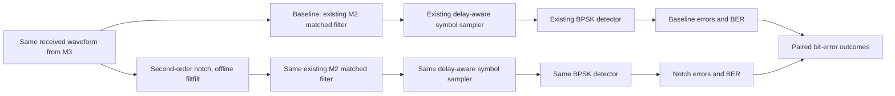

# SignalShield M4 — Receiver Improvement and Signal Recovery Evaluation

## Status

- **Implementation:** complete for M4's offline notch-filter receiver and paired evaluation.
- **Execution:** the clean, AWGN-only, matched-tone, amplitude, and frequency-mismatch experiments ran successfully.
- **Verification:** full M1–M4 suite passed: **60 passed**.
- **Engineering conclusion:** the notch substantially improves BER when its center matches the configured 0.35 cycles/symbol tone. It degrades the AWGN-only control and several frequency-mismatch cases. The improvement is conditional, not general.
- **Scope:** M5 and M6 were not started.

## 1. Executive summary

M4 adds a second-order IIR notch filter before the unchanged M2 matched-filter receiver. The design uses `scipy.signal.iirnotch`; filtering is performed with forward-backward `scipy.signal.filtfilt`, with explicit odd padding. This is a zero-phase, offline and **noncausal** operation. It is not presented as a real-time receiver.

The primary paired trial used the same 30,000 transmitted bits and exact M3 received waveform for both paths: 6 dB configured Eb/N0, tone peak 0.22, tone at 0.35 cycles/symbol, phase 0.37 rad, notch center 0.35 cycles/symbol, and Q=30. Baseline BER was **0.032133** (964 errors); notch BER was **0.004400** (132 errors). The measured tone component fell by **74.28 dB** in the interior least-squares amplitude estimate. The paired candidate-minus-baseline BER difference was −0.027733, with a 50-bit block-bootstrap 95% interval of **[−0.029601, −0.025800]**.

The notch also distorted the desired pulse-shaped signal: interior relative RMS error was 13.08%, and desired-signal RMS gain was 0.9743. The AWGN-only control showed the cost of filtering without a tone: BER increased from 0.002367 to 0.004333. With the notch center fixed at 0.35, actual tones at 0.31, 0.33, 0.37 and 0.39 cycles/symbol produced worse BER than the baseline. Thus the result supports the stated hypothesis only when the notch is sufficiently well matched to a strong tone.

## 2. Repository and environment inspection

- Workspace: project root (portable relative paths).
- Python 3.11.5; project environment packages: NumPy 2.4.6, SciPy 1.17.1, Matplotlib 3.11.2, pytest 9.1.1.
- Inspected existing channel, receiver, filter, configuration, metrics, M3 experiment code, M1–M3 reports, tests, and engineering documents before implementation.
- The existing M2 receiver already performs full matched filtering, delay-aware sampling, and BPSK decisions. The M3 channel returns a single realized received waveform and its component arrays. The M4 comparison reuses those interfaces.
- This workspace has no `.git` repository; Git status/diff is unavailable. M1–M3 artifacts remain in place; new implementation and results are in the existing package and `results/m4/`.
- No new dependency was installed.
- The first experiment attempt exposed a result-writer issue: control rows and diagnostic rows had different CSV columns. The writer was corrected to form the union of row fields, and the entire experiment then completed. The final run log contains the successful execution.

## 3. Receiver architectures



The baseline branch directly calls `receive_bpsk_waveform`. The candidate filters the input waveform and calls that same receiver. Both branches receive the same array; neither changes the channel or transmitted bits. The M2 sampler still uses the original full-convolution decision indices. `filtfilt` preserves record length and has zero-phase forward-backward response, so there is no integer delay correction; its finite-record boundaries remain a limitation and are handled by explicit padding and interior diagnostics.

## 4. Notch design and conventions

`NotchConfig` is in `src/signalshield/config.py`. It validates:

- Center frequency in cycles/symbol and strictly inside `0 < f0 < samples_per_symbol/2`.
- Integer samples per symbol, at least 2.
- Quality factor in the documented supported range **0.5 ≤ Q ≤ 1000**, finite and positive.

The filter is designed by `iirnotch(w0=f0, Q=Q, fs=samples_per_symbol)`, so SciPy's frequency units match M3's cycles/symbol convention. For the primary case, `f0=0.35`, `sps=8`, `Q=30`. The approximate 3 dB bandwidth scale is `f0/Q ≈ 0.0117` cycles/symbol.

`apply_notch` uses `filtfilt(b, a, samples, padtype="odd", padlen=9)`. The input must be finite, real, one-dimensional and at least 10 samples long. Output length and dtype are preserved; input is not modified; nonfinite output is rejected. The operation is deterministic. The second-order denominator poles were verified inside the unit circle.

Both responses are saved: single-pass magnitude `|H(f)|` and the effective forward-backward magnitude `|H(f)|²`. The latter is the magnitude relevant to `filtfilt`, not a claim that this noncausal process is a physical zero-delay system. `m4_notch_frequency_response.csv` contains frequency, magnitudes and dB values. Coefficients and processing details are in the JSON files.

### Documentation reconciliation

Older system design text specified a causal notch and prohibited using `filtfilt` for BER claims. The M4 request explicitly allows forward-backward filtering for this offline educational simulator, while requiring it to be identified as noncausal. I followed the M4 request and updated the system design, handoff, and validation text to distinguish offline evaluation from a causal real-time receiver. No real-time benefit is claimed.

## 5. Paired methodology and statistics

Each trial generates one bit sequence and one shaped waveform. The channel is applied once per condition. The same resulting `received` array feeds both receiver paths. Within the amplitude sweep and mismatch sweep, all points reuse the same bit sequence and the same AWGN seed; only the stated tone parameter changes. Seed metadata is written to CSV and JSON.

For each pair, the saved results include errors, bits, BER, two-sided exact 95% Clopper–Pearson intervals, BER difference `notch − baseline`, corrected errors, introduced errors, and unchanged bit decisions. The paired-difference interval uses a contiguous **50-bit block bootstrap with 1,000 replicates** and fixed bootstrap seeds. The exact two-sided McNemar test is also recorded on discordant outcomes. Its usual p-value interpretation assumes independent discordant pairs; filtering and pulse shaping can create temporal dependence, so the block-bootstrap interval is the more relevant uncertainty summary here. The chosen block size was not varied, so that interval remains an approximation rather than a universal coverage guarantee.

## 6. Experiment configuration

The actual command was:

```powershell
.\.venv\Scripts\python.exe -m signalshield.m4_experiments --n-bits 30000 --seed 20261030 --quality-factor 30 --output-dir results/m4
```

The final run took **2.347 seconds**. Main configuration: 30,000 bits; master seed 20261030; recorded bit seed 1306115188; primary tone-noise seed 380539748; `sps=8`; rolloff 0.35; RRC span 10; configured Eb/N0 6 dB; tone amplitude 0.22 peak; tone phase 0.37 rad; notch center 0.35 cycles/symbol; Q=30.

Controls were clean/noiseless and AWGN-only. The amplitude sweep was `[0, 0.08, 0.16, 0.22, 0.30, 0.42]` peak units. The fixed-center mismatch sweep used actual tone frequencies `[0.31, 0.33, 0.34, 0.35, 0.36, 0.37, 0.39]` cycles/symbol, i.e. offsets from −0.04 through +0.04 around the 0.35-cycle notch. Each sweep point reused its sweep's bit/noise realization.

## 7. Numerical results

### Controls and primary matched-tone comparison

| Condition | Baseline errors / BER (95% exact CI) | Notch errors / BER (95% exact CI) | Paired BER difference, notch − baseline (95% block CI) |
|---|---|---|---|
| Clean, no AWGN/tone | 0/30000; 0 [0, 0.000123] | 0/30000; 0 [0, 0.000123] | 0 [0, 0] |
| AWGN only, 6 dB | 71/30000; 0.002367 [0.001849, 0.002984] | 130/30000; 0.004333 [0.003622, 0.005143] | +0.001967 [+0.001333, +0.002600] |
| Tone at 0.35, amplitude 0.22 | 964/30000; 0.032133 [0.030166, 0.034191] | 132/30000; 0.004400 [0.003683, 0.005216] | −0.027733 [−0.029601, −0.025800] |

For the primary tone case, 894 baseline errors were corrected by the notch and 62 new errors were introduced; 29,044 decisions were unchanged. The measured BER reduction was about **86.3%**. The McNemar exact p-value was approximately `9.12e-190`; the block-bootstrap difference interval also excludes zero. These results support improvement for this specific matched-tone condition. The filter is not a universal BER improvement: it worsened the AWGN-only control by 59 errors, with a positive paired BER difference interval.

The clean case had no observed errors in either path. That is 0/30,000, not proof of zero true BER; its one-sided 95% upper bound is separately reported as approximately 0.000100 for the one-sided bound calculation and its two-sided interval upper endpoint is 0.000123.

### Interference amplitude sweep

The fixed settings were 6 dB Eb/N0, tone at 0.35 cycles/symbol, phase 0.37 rad, Q=30, and common bits/noise. The notch BER stayed at 136/30,000 (0.004533) across all amplitudes in this particular paired realization because the notch removes the deterministic component and leaves the same desired-plus-noise path.

| Tone peak amplitude | Baseline BER | Notch BER | Paired difference, notch − baseline (95% block CI) |
|---:|---:|---:|---:|
| 0.00 | 0.002767 | 0.004533 | +0.001767 [+0.001133, +0.002400] |
| 0.08 | 0.004933 | 0.004533 | −0.000400 [−0.001267, +0.000500] |
| 0.16 | 0.014333 | 0.004533 | −0.009800 [−0.011134, −0.008366] |
| 0.22 | 0.030533 | 0.004533 | −0.026000 [−0.028033, −0.023999] |
| 0.30 | 0.071233 | 0.004533 | −0.066700 [−0.069635, −0.063899] |
| 0.42 | 0.167267 | 0.004533 | −0.162733 [−0.166768, −0.158731] |

At zero tone, the notch incurs a cost. At amplitude 0.08, the paired interval crosses zero and does not resolve an improvement. From 0.16 upward, the paired intervals are below zero for this run. The complete per-receiver errors and exact intervals are in the CSV.

### Frequency mismatch sweep

The notch center remains fixed at 0.35 cycles/symbol. Each row uses amplitude 0.22 and phase 0.37 rad.

| Actual tone frequency | Offset from notch | Baseline BER | Notch BER | Difference (notch − baseline), 95% block CI | Measured tone attenuation |
|---:|---:|---:|---:|---:|---:|
| 0.31 | −0.04 | 0.031533 | 0.039033 | +0.007500 [+0.005833, +0.009134] | −0.162 dB |
| 0.33 | −0.02 | 0.030633 | 0.034133 | +0.003500 [+0.001933, +0.005067] | −0.670 dB |
| 0.34 | −0.01 | 0.033400 | 0.022067 | −0.011333 [−0.013000, −0.009632] | −2.483 dB |
| 0.35 | 0.00 | 0.031833 | 0.004467 | −0.027367 [−0.029433, −0.025432] | −74.278 dB |
| 0.36 | +0.01 | 0.031500 | 0.020767 | −0.010733 [−0.012367, −0.009066] | −2.606 dB |
| 0.37 | +0.02 | 0.029033 | 0.031800 | +0.002767 [+0.001267, +0.004367] | −0.746 dB |
| 0.39 | +0.04 | 0.029033 | 0.035967 | +0.006933 [+0.005333, +0.008468] | −0.202 dB |

The notch's rejection degrades quickly with frequency error. At ±0.01 cycles/symbol, measured suppression is only about 2.5 dB, yet BER still improves in these trials. At ±0.02 and ±0.04, suppression is below 1 dB and BER is worse than the baseline. This asymmetry reflects the finite waveform, phase, fixed bit/noise realization and receiver sampling; it should not be generalized from one seed.

### Filter and waveform diagnostics

Measured on the primary matched-tone realization, with tone amplitude estimated by least-squares cosine/sine fit after excluding 200 samples at each boundary:

| Measurement | Before notch | After notch / result |
|---|---:|---:|
| Tone fitted peak amplitude | 0.220000 | 0.0000425 |
| Tone attenuation | — | −74.278 dB |
| Desired signal record power | 0.124947 | 0.118608 |
| Desired-signal interior RMS gain | 1.000 | 0.9743 |
| Desired-signal interior relative RMS distortion | — | 0.1308 (13.08%) |
| AWGN sample variance | 0.126062 | 0.125176 (interior) |
| AWGN decision-sample variance after notch and M2 matched filter | — | 0.119783 |
| Total received record mean-square power | 0.274155 | 0.243456 |

The total power decrease alone is not evidence of recovery: the notch removes the tone, reduces some desired-signal energy, and shapes the noise. The BER comparison and desired-signal distortion measurement are therefore reported together. The AWGN-only control directly measures the effect of that extra filtering when there is no structured tone.

## 8. Plots and saved artifacts

Eight plots were generated from the actual run:

1. `m4_notch_frequency_response.png` — single-pass and effective forward-backward response with configured center marked.
2. `m4_interference_before_after_time.png` — configured tone before/after filtering.
3. `m4_received_spectrum_before_after.png` — received interior spectrum before/after filtering on a common scale.
4. `m4_desired_signal_distortion.png` — desired waveform alone before/after filtering.
5. `m4_main_baseline_vs_notch_ber.png` — primary matched-frequency condition.
6. `m4_ber_vs_interference_amplitude.png` — full predefined amplitude sweep.
7. `m4_ber_vs_frequency_mismatch.png` — fixed-center mismatch sweep.
8. `m4_awgn_only_control.png` — AWGN-only baseline/candidate comparison.

Numerical/configuration outputs in `results/m4/`:

- `m4_experiment_config.json` — complete main configuration, seeds, receiver paths, filter mode, and statistical methods.
- `m4_receiver_comparison.csv` — clean, AWGN-only, and primary matched-tone comparisons.
- `m4_interference_amplitude_sweep.csv` and `m4_frequency_mismatch_sweep.csv` — per-point results, paired counts, uncertainty, and diagnostics.
- `m4_notch_frequency_response.csv` — sampled single-pass and forward-backward response.
- `m4_filter_diagnostics.json` — coefficients, measured tone attenuation, desired-signal distortion, noise and total-power diagnostics.
- `m4_filter_diagnostic_waveforms.csv` — first 2,048 samples of transmit, received, tone, desired and noise arrays before/after filtering.
- `experiment_run.txt` and `test_run.txt` — actual command output.

## 9. Automated verification

Full command:

```powershell
.\.venv\Scripts\python.exe -m pytest -q
```

Actual outcome: **60 passed in 2.81s**; no failures or skips. The M1–M3 tests remain unchanged and passed as part of the full suite (45 pre-M4 tests, plus 15 M4 tests). M4 tests cover configuration validation, exact notch location and compatible units, stable poles, response magnitudes, deterministic finite length-preserving output, non-mutation, minimum filtfilt record length, center-tone suppression, mismatch response, baseline receiver identity, noiseless recovery, paired counts, and repeatability.

The main command and actual output are recorded in `results/m4/experiment_run.txt`. The config JSON records Python and numerical-library versions.

## 10. Statistical interpretation and limitations

- The baseline and notch BER intervals are exact binomial intervals, but temporal dependence can violate a simple independent-bit interpretation after filtering. Paired 50-bit block bootstrap intervals were added for the BER difference; block length was not sensitivity-tested.
- McNemar p-values use discordant bit outcomes and are reported as a diagnostic. Their independent-pair assumption is imperfect for pulse-shaped and filtered records. The matched-tone result is also supported by a block-bootstrap interval entirely below zero; the AWGN-only and mismatch degradation intervals are entirely above zero for the reported run.
- Results use one fixed 30,000-bit stream per experiment and fixed seeds. They establish reproducible behavior for those configurations, not a broad performance distribution over seeds.
- The candidate assumes the tone frequency is known. No estimator or adaptive notch is implemented. The mismatch sweep shows why this assumption matters.
- `filtfilt` is offline and noncausal; its zero-phase response cannot support real-time claims. Padding reduces boundary artifacts but does not remove finite-record effects.
- Q=30 is one evaluated setting. There is no Q sweep or automatic tuning.
- The notch changes desired signal and AWGN responses as well as the tone. Desired-signal RMS distortion was measured; no generic AWGN-only theory is claimed for the notch receiver.
- The M3 finite-RRC, known-timing, normalized discrete-noise model remains in force. This is not an RF propagation, fading, multipath, synchronization, coding, or security simulator.
- No unresolved software acceptance blocker remains within M4's stated model. Physical realism, robustness across many independent seeds, alternative Q values, and causal real-time operation are not verified by design.

## 11. Reproduction

From the existing workspace and environment:

```powershell
.\.venv\Scripts\python.exe -m pytest -q
.\.venv\Scripts\python.exe -m signalshield.m4_experiments --n-bits 30000 --seed 20261030 --quality-factor 30 --output-dir results/m4
```

The console entry point `signalshield-m4` is also registered in `pyproject.toml` after package installation.

## 12. M4 acceptance matrix

| Requirement | Verification and observed outcome | Evidence | Status |
|---|---|---|---|
| Inspect M1–M3 interfaces and preserve them | Reused M3 channel and unchanged M2 receiver; complete regression passes | Source, 60-test log | PASS |
| Define baseline and candidate receiver paths | Candidate inserts notch before same M2 receiver; same received array used | `m4_experiments.py`, comparison CSV | PASS |
| Validate frequency and Q configuration | Invalid/DC/Nyquist/out-of-range/nonfinite inputs rejected | `tests/test_notch_m4.py` | PASS |
| Confirm notch location and stability | `iirnotch` response reaches notch at 0.35; poles inside unit circle | response CSV, filter tests | PASS |
| Preserve length, finite values and deterministic behavior | Verified across fixed inputs, with minimum length 10 | filter tests | PASS |
| Measure interference rejection and desired-signal distortion | −74.278 dB tone amplitude; 13.08% relative desired-signal RMS distortion | diagnostics JSON/CSV | PASS |
| Clean/noiseless control | Both receivers recover 30,000/30,000 bits | comparison CSV | PASS |
| AWGN-only control | Run; notch BER increases from 0.002367 to 0.004333 | comparison CSV, AWGN plot | PASS |
| Matched-frequency interference comparison | Run; notch BER decreases 0.032133 → 0.004400; paired block CI excludes zero | comparison CSV, primary plot | PASS |
| Interference amplitude sweep | Six predeclared levels, including zero, run with common bits/noise | amplitude CSV and plot | PASS |
| Frequency-mismatch sensitivity | Seven actual frequencies around fixed notch center run | mismatch CSV and plot | PASS |
| Paired error outcomes and uncertainty saved | Corrected/introduced/unchanged counts, McNemar and block-bootstrap intervals saved | Three comparison CSVs | PASS |
| Required plots/results/logs produced | Eight plots, CSV/JSON diagnostics and actual logs exist | `results/m4/` | PASS |
| Full M1–M3 regression | 45 existing tests pass within the full 60-test run | `test_run.txt` | PASS |
| Report and docs reflect offline mode and measured tradeoffs | Architecture/handoff/plan/README updated; no causal claim | documentation and this report | PASS |
| M5/M6 scope not started | No generalized M5 framework or M6 packaging work performed | workspace scope record | PASS |

## 13. شرح هندسي بالعربية

### مسار المستقبلين

المستقبل الأساسي لا يزال كما في M2: يمرر عينات الاستقبال إلى matched filter، ثم يأخذ عينات الرموز عند فهارس التأخير المعروفة، ثم يقرر البتات بكاشف BPSK نفسه. المستقبل المرشح يأخذ **نسخة عينات الاستقبال نفسها**، يطبق notch أولًا، ثم يستخدم matched filter وأخذ العينات والكاشف نفسيهما. لذلك تظل المقارنة عادلة من ناحية البيانات والقناة، والاختلاف المقصود هو وجود المرشح فقط.

### المرشح وطريقة تشغيله

صممت notch من الدرجة الثانية باستخدام `iirnotch`، ومركزها بوحدة cycles/symbol. استخدمت Q=30 ومركزًا 0.35 عند ثماني عينات لكل رمز. بعد ذلك طبقت `filtfilt` بتمرير أمامي وخلفي وحشو odd بطول 9 عينات. هذه معالجة غير سببية ومناسبة لتحليل سجل محفوظ، لكنها ليست مستقبلًا آنيًا. طول الموجة يبقى كما هو، ولا أزحزح مؤشرات القرار في M2. مع ذلك، تظل آثار حدود السجل ممكنة.

### هل تحسن BER؟

في الحالة الأساسية، كان التداخل عند التردد المعروف نفسه الذي ضُبطت عليه notch. انخفضت الأخطاء من 964 إلى 132 من أصل 30,000 بت، أي من BER 3.21% إلى 0.44%. وقد انخفضت سعة النغمة المقدرة في الجزء الداخلي بنحو 74 dB. فاصل bootstrap للفرق المقترن BER_notch−BER_base كان سالبًا بالكامل، ما يدعم التحسن لهذه الحالة.

لكن notch ليست مجانية. في AWGN-only، ارتفعت الأخطاء من 71 إلى 130، لأن المرشح يغير الإشارة المطلوبة والضوضاء حتى حين لا توجد نغمة لإزالتها. كما أن التشويه النسبي RMS للإشارة المطلوبة بعد المرشح بلغ 13.08%. عند عدم تطابق التردد بمقدار 0.02 أو 0.04 cycles/symbol، لم تخفض notch النغمة إلا بأقل من 1 dB تقريبًا، وأصبح BER أسوأ من الأساس في القياسات المعروضة. لذلك النتيجة هي **تحسن قوي عند معرفة تردد النغمة وضبط المركز عليه، مع حساسية واضحة للانحراف وتكلفة عند غياب التداخل**.

### القيود الإحصائية والهندسية

استُخدمت بيانات وضوضاء متطابقة للمستقبلين، وحُفظت حالات البتات التي صححها المرشح أو أخطأ فيها، لا BER فقط. استُخدم bootstrap بكتل متجاورة من 50 بت لتقدير فرق BER، لأن أخطاء العينات المتجاورة قد تكون مترابطة. أُرفق اختبار McNemar أيضًا، لكن تفسيره يفترض استقلال النتائج المتخالفة وهو افتراض تقريبي هنا. النتائج مبنية على بذور واحدة و30,000 بت لكل حالة، ولا تثبت الأداء عبر كل البذور أو القنوات. كما أن filter `filtfilt` غير سببي، ولا توجد آلية لتقدير تردد التداخل تلقائيًا.

## 14. توصية الخطوة التالية

يمكن أن يبدأ M5 لاحقًا بتوسيع إدارة التجارب وتحليل الحساسية عبر عدة بذور وقيم Q، مع الاحتفاظ بمقارنات مستقبل مقترنة وقياسات التشويه. ينبغي إبقاء notch الحالية baseline مرشحًا محدود الافتراضات، وعدم تعميم نجاح الحالة المتطابقة على الحالات التي لا يُعرف فيها تردد التداخل. لم يبدأ أي من أعمال M5 في هذا التنفيذ.
