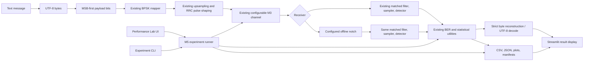

# SignalShield M6 Final Validation Report

**Milestone:** M6 — System Integration, Interactive Application, Final Validation & Delivery  
**Report date:** 2026-10-28  
**Overall status:** PASS for the implemented educational simulator and local UI; ready for engineering review  
**Publishing caveats:** direct browser interaction/visual review was not performed, and the project owner has not selected a software license.

## A. Executive summary

M6 integrates the validated M1–M5 communication simulation with a local Streamlit user interface and adds a UI-independent UTF-8 payload adapter. The UI sends actual encoded bits through the existing BPSK, RRC waveform, channel, matched-filter, detector, and metric functions. Its paired mode passes the same realized received waveform to baseline and notch receivers. Its Performance Lab calls the existing M5 runner and writes the established M5 schemas.

The application has the requested three tabs: **Message Transmission**, **Channel & Receiver Analysis**, and **Performance Lab**. It displays actual input bytes/bits, decisions, error counts, payload BER, strict decoding status, waveform/channel plots, and paired metrics. Performance experiments are stored in unique folders. Results are hidden when current settings no longer match the saved run.

Final verification ran six UTF-8 payload cases, a 50,000-bit/two-repetition AWGN reference benchmark, a saved-configuration replay, a Streamlit server health check, Streamlit `AppTest` interactions, and the entire regression suite. The suite result was **83 passed in 8.27 seconds**. The long-run result CSV matched across replay in every non-runtime field, the aggregate CSV matched exactly, and plots were regenerated.

The project is suitable for engineering review and local demonstration. It is not a physical radio or real-time receiver. A human should review the UI in a browser before publishing screenshots, and the project owner must choose a license before public redistribution.

## B. Final architecture



### Component responsibilities

- **Signal engine:** `signals.py`, `modulation.py`, `waveform.py`, `filters.py`, `channel.py`, `receiver.py`, `notch.py`. These implement seeded bit generation, BPSK mapping, RRC shaping, M3 channel components, matched filtering, timing, and receiver paths.
- **Metrics:** `metrics.py` calculates BER from actual transmitted/detected arrays, exact binomial intervals, BPSK theory, and paired uncertainty utilities.
- **M5 experiment orchestration:** `experiment_framework.py` and `experiment_runner.py` validate configs, derive seeds, run scenarios, create result rows, summarize and plot them, and save replayable configuration and manifests.
- **Message adapter:** `application.py` translates UTF-8 to MSB-first bits, composes existing signal functions, strictly decodes output, and packages actual payload/receiver outcomes. It is usable without Streamlit.
- **UI:** `streamlit_app.py` handles tabs/forms, validation messages, plots generated from result arrays, paired comparisons, downloads, and the Performance Lab. It does not implement an alternate modem or BER calculation.
- **Validation script:** `scripts/run_m6_validation.py` executes the documented M6 end-to-end cases and saved-config replay.

## C. Final implementation inventory

| File | Change and responsibility |
|---|---|
| `src/signalshield/application.py` | New UI-independent validated message config; UTF-8/bit conversion; engine integration; receiver outcomes; strict decoding; comparison metrics and stale-result identity. |
| `src/signalshield/streamlit_app.py` | New three-tab Streamlit application; message transmit form; actual-array visualizations; channel/receiver analysis; M5 Performance Lab; config-bound result display and file downloads. |
| `tests/test_application_m6.py` | New integration/UI-facing tests for encoding, invalid UTF-8, validation, mapping, waveform length, filter energy, sampling indices, channel propagation, paired paths, stale IDs, M5 runner use, and Streamlit `AppTest`. |
| `scripts/run_m6_validation.py` | New repeatable end-to-end validation driver; payload case results, compressed arrays and figures; long M5 benchmark and replay comparison. |
| `pyproject.toml` | Added optional `app` dependency extra (`streamlit>=1.50`) and updated package description. |
| `requirements.txt` | Refreshed to the exact Python environment resolved during M6 verification, including Streamlit and its dependencies. |
| `README.md` | Reframed as final project README; setup, app/CLI/test/validation commands, architecture, findings, figures, limits, and license note. |
| `docs/user_guide.md` | New app and experiment walkthrough using implemented labels and commands. |
| `docs/system_architecture.md` | New layer and data-flow architecture diagram and implementation mapping. |
| `docs/portfolio_summary.md` | New technically bounded portfolio summary with measured results and limitations. |
| `docs/system_design.md` | Reconciled prior GUI exclusion and dependencies with the approved M6 Streamlit layer. |
| `docs/validation_and_experiments.md` | Added final M6 integration and verification evidence. |
| `docs/implementation_plan.md` | Updated actual M6 milestone status and evidence. |
| `docs/codex_handoff.md` | Reconciled the handoff scope with the offline notch and final Streamlit app. |
| `.gitignore` | Added Streamlit secrets, Ruff cache, and transient Performance Lab outputs to existing exclusions. |
| `results/m6/validation/` | Saved payload summaries, arrays, diagnostic plots, M5 benchmark and replay outputs, smoke records, and test output. |

Historical M1–M5 reports and result directories were not rewritten.

## D. Interactive application

### Implemented user flow

**Message Transmission** accepts a short text payload, UTF-8 encodes it, displays bytes and a truncated bit preview, then passes the bits through the M2 sampled waveform and configured M3 channel. The user can toggle AWGN and tone, set Eb/N0, tone amplitude/frequency/phase, attenuation, samples/symbol, RRC parameters, random seed, and receiver. The notch center and Q are configurable; the app states that the frequency is not automatically estimated.

The app reports recovered bits, actual bit errors, payload BER, recovered text when valid, strict UTF-8 failure when invalid, and whether the original text was recovered exactly. When both receivers are selected, the comparison tab shows BER difference, corrected/introduced/shared errors, tone attenuation, wanted-signal RMS gain, and relative signal distortion. It explicitly warns that a short payload does not establish significance.

Plots use arrays produced by the current simulation: Tx waveform, received waveform, actual channel components when enabled, matched-filter output, decision indices, and a received spectrum when a tone is present. The default display is limited to 1,800 samples and labels the display window. No unrelated interference trace is shown for a tone-free run.

**Performance Lab** selects a supported M5 scenario, number of bits, repetitions, seed, Eb/N0, and sweep values. It calls `run_experiment`, displays raw rows (including theory applicability and confidence intervals), provides CSV/manifest downloads, and shows saved figures. It records output beneath `results/m6/performance/`. Partial or failed runner status is shown rather than described as a complete run.

### Launch and smoke verification

Installation command:

```powershell
.\.venv\Scripts\python.exe -m pip install -e ".[dev,app]"
```

Launch command used for the M6 check:

```powershell
.\.venv\Scripts\python.exe -m streamlit run src\signalshield\streamlit_app.py --server.headless true --server.port 8503 --server.address 127.0.0.1 --browser.gatherUsageStats false
```

Observed result: the server started on `127.0.0.1:8503`, the app root returned HTTP 200, and `/_stcore/health` returned HTTP 200 with body `ok`. Evidence is `results/m6/validation/streamlit_startup_smoke.json`.

`streamlit.testing.v1.AppTest` exercised all three tabs, the message form in a clean case, the Performance Lab run, and stale-result suppression after changing the selected performance scenario. It reported no Streamlit exceptions. Evidence is `results/m6/validation/streamlit_apptest_smoke.json`; AppTest is browserless. **No actual browser screenshot or human browser session was captured**, so final browser-level appearance and interaction remain NOT VERIFIED.

The AppTest utility emits Streamlit's informational `missing ScriptRunContext` message when run directly in bare mode; Streamlit documents that as expected for this test context. The full pytest run reported no warning summary.

## E. Final automated test results

Full regression command:

```powershell
.\.venv\Scripts\python.exe -m pytest -q
```

Actual result captured at `results/m6/validation/test_run.txt`:

```text
83 passed in 8.27s
```

There were no failed or skipped tests and pytest printed no warning summary. The 83 tests include the preserved M1–M5 suite and nine M6 tests. The M6 tests exercise UTF-8 round trips, invalid UTF-8 rejection, config validation, noiseless payload integration, BPSK mapping, waveform length, tap energy, sample indices, BER/count consistency, actual channel component propagation, same-input paired receivers, stale configuration identity, M5 experiment-runner artifacts, and Streamlit message-form execution.

## F. End-to-end validation results

The controlled validation command was:

```powershell
.\.venv\Scripts\python.exe scripts\run_m6_validation.py --output-dir results/m6/validation --n-bits 50000 --repetitions 2 --seed 20261030
```

The payload cases used the same fixed, 1,752-bit UTF-8 test message except for channel/receiver configuration. The script saved each case's resolved settings, measured output, decoded text/status, NPZ signal arrays, and waveform PNG.

| Required case | Actual configuration | Actual result |
|---|---|---|
| Clean transmission | AWGN off, tone off, 0 dB attenuation, baseline, seed 101 | 0/1,752 errors; exact UTF-8 message recovery. Tx and Rx waveform shapes matched; signal path used existing BPSK/RRC/matched receiver. |
| AWGN-only payload | AWGN on, 6 dB, no tone, baseline, seed 2026 | 5/1,752 errors; BER 0.0028539. The bits decoded as valid UTF-8 but the recovered text differed. This is reported as payload corruption, not successful recovery. |
| Matched tone pair | AWGN 6 dB, tone 0.40 peak at 0.35 cycles/symbol, phase 0.37 rad, notch center 0.35, Q=30, seed 303 | Baseline 255/1,752 (BER 0.145548); notch 11/1,752 (BER 0.00627854); ΔBER = -0.139269. Notch corrected 253 errors, introduced 9, shared 2. Measured tone attenuation -26.75 dB; wanted-signal RMS gain 0.9689 and relative RMS distortion 0.1359. |
| Frequency mismatch | AWGN 6 dB, actual tone 0.60, notch center 0.35 cycles/symbol, amplitude 0.40, Q=30, seed 404 | Baseline 20/1,752 (BER 0.0114155); notch 29/1,752 (BER 0.0165525); ΔBER = +0.005137. The notch introduced 15 and corrected 6 errors; measured tone attenuation was about -0.007 dB. This is an actual mismatch degradation example. |
| Attenuation | AWGN off, tone off, 6 dB desired-signal attenuation, baseline, seed 505 | Voltage gain 0.501187; 0/1,752 errors and exact message recovery. This isolates positive gain scaling from noise-induced errors. |
| Baseline/notch paired comparison | AWGN 6 dB, tone 0.32 peak at 0.35 cycles/symbol, phase 1.2 rad, center 0.35, Q=30, seed 606 | Baseline 137/1,752 (BER 0.0781963); notch 4/1,752 (BER 0.00228311); ΔBER = -0.0759132. Notch corrected 135, introduced 2, shared 2. Both branches used the same bits, Tx waveform, channel output, and received samples. |

The short message payload is intentionally not presented as a statistically meaningful BER study. It demonstrates actual bit/byte behavior and selected configurations, including both improvement and degradation.

### Long-run benchmark

The M5 `awgn_reference` runner was configured for 50,000 bits/run, two independent repetitions, master seed `20261030`, and Eb/N0 values 0, 4, and 8 dB. There were six successful rows and no failed points.

| Eb/N0 | Measured mean BER (two runs) | Coherent BPSK/AWGN theory |
|---:|---:|---:|
| 0 dB | 0.07899 | 0.0786496 |
| 4 dB | 0.01233 | 0.0125008 |
| 8 dB | 0.00019 | 0.000190908 |

Measurements are consistent with the reference values at this sample size. The 8 dB row observed 8 and 11 errors in the two 50,000-bit runs, not zero errors. The per-run exact and Bonferroni-adjusted intervals are preserved in `results.csv`; run-to-run intervals from two repetitions are descriptive, not strong population estimates.

## G. Reproducibility

The validation script loaded `results/m6/validation/long_run_awgn/resolved_config.json`, replayed it into `long_run_reproduction/`, and regenerated result files and plots.

- Primary and replay configuration ID: `cd410eed8cd51916`.
- Both runs completed successfully.
- Raw CSV values matched exactly after excluding only `runtime_seconds`: **336 fields compared**.
- Aggregate CSV matched exactly: **39 fields compared**.
- `ber_by_condition.png` and `run_variability.png` were regenerated.
- Reproducibility record: `results/m6/validation/long_run_reproducibility.json`.

Runtime differs by design and is the only excluded raw-results field. Seeds, raw error counts, BER, confidence bounds, configuration metadata, and aggregate summaries match.

## H. Numerical and statistical validation

M1–M5 unit and integration tests remained in the full suite. New M6 tests checked the combined interfaces, including the explicit BPSK mapping `symbol = 1 - 2*bit`, unit-energy RRC taps, expected waveform shape, M2 decision sample indices `span_symbols*samples_per_symbol + k*samples_per_symbol`, channel component sum, attenuation gain, and BER recomputed from detected decisions.

AWGN is disabled by passing `ebn0_db=None` to the existing channel; no alternate variance is substituted. When enabled, the established real-sample variance is `Eb/(2·10^(Eb/N0_dB/10))`. The channel remains `g*s[n] + tone[n] + noise[n]`; gain applies to the desired waveform only. Paired comparison uses a single `ChannelOutput` object for both receiver branches.

The AWGN reference theory is reported only in its valid no-tone/no-notch model. The payload result table does not overlay theory on tone or notch runs. The exact binomial intervals are saved per payload run, but temporal dependence in a filtered waveform means they are not a complete model of payload-error dependence. No significance claim is inferred from the payload delta. Existing M5 block-bootstrap and McNemar caveats remain documented in the M5 report.

The finite truncated RRC taps are normalized to unit energy; finite-filter residual ISI remains possible and is not described as exactly zero. The clean/noiseless payload test happened to recover exactly under its tested payload and parameters; that does not remove the finite-filter limitation.

## I. Documentation, installation, and outputs

Installation tested in the project environment:

```powershell
.\.venv\Scripts\python.exe -m pip install -e ".[dev,app]"
```

Recorded environment: Python 3.11.5, NumPy 2.4.6, SciPy 1.17.1, Matplotlib 3.11.2, pytest 9.1.1, pandas 3.1.0, and Streamlit 1.66.1. `pyproject.toml` defines the app extra; `requirements.txt` captures the resolved environment. The project uses no license declaration and no license file; the owner must select one before public distribution.

Current user-facing documents are `README.md`, `docs/user_guide.md`, `docs/system_architecture.md`, `docs/system_design.md`, `docs/validation_and_experiments.md`, `docs/implementation_plan.md`, `docs/portfolio_summary.md`, and the M1–M6 reports. The README documents Windows setup, launch, tests, M5 CLI, M6 validation, result paths, actual figures, findings, and boundaries.

Important M6 evidence paths:

- `results/m6/validation/payload_validation_summary.csv` and `.json` — all six payload cases and receiver rows.
- `results/m6/validation/payload_cases/<case>/summary.json` — case config, payload, errors, BER, recovery, and pair metrics.
- `results/m6/validation/payload_cases/<case>/trace_arrays.npz` — transmitted/received/component arrays and actual receiver outputs.
- `results/m6/validation/payload_cases/<case>/waveform_diagnostics.png` — figures generated from those arrays.
- `results/m6/validation/long_run_awgn/` and `long_run_reproduction/` — M5 results, config, summaries, manifests, and plots.
- `results/m6/validation/streamlit_startup_smoke.json`, `streamlit_apptest_smoke.json`, and `test_run.txt` — current application and test evidence.
- `results/m6/performance/` — unique actual UI Performance Lab outputs from app smoke runs; ignored from Git because they are repeatable generated run folders.

No Git repository was initialized, no commit was created, and no remote was changed. `.gitignore` excludes environments, caches, Streamlit secrets, build artifacts, and transient Performance Lab run folders while preserving curated M6 validation evidence. No screenshot was fabricated or captured. The actual data-driven plots are included.

## J. Final acceptance matrix

| Requirement | Verification method | Actual evidence | Status |
|---|---|---|---|
| Existing M1–M5 algorithms integrated without replacement | Source audit plus complete regression suite | Existing engine modules called by `application.py` and M5 runner; 83 tests passed | PASS |
| Core engine remains callable without a UI | Import/API and direct `run_message_simulation` tests | `application.py` has no Streamlit import; 8 focused numerical integration cases pass | PASS |
| Text is encoded UTF-8 bytes to MSB-first bits | Round-trip tests including Arabic/emoji; app form execution | `test_application_m6.py`; payload summary records byte hex and bit count | PASS |
| Corrupt/invalid UTF-8 is reported strictly | Invalid-byte test and AWGN payload scenario | Invalid UTF-8 test; AWGN valid-but-different decode preserved distinctly | PASS |
| Tx waveform length, unit-energy pulse, sampling alignment, and BPSK mapping preserved | Integrated M6 assertions plus previous M2 tests | Expected length/taps/indices and `1-2b` mapping verified | PASS |
| Channel controls bind to actual channel arrays and settings | Integration test and saved case JSON/NPZ | Attenuation gain and exact component sum asserted; actual tone/noise arrays saved | PASS |
| Baseline and notch use identical paired inputs | Integration assertions and paired outputs | Same bits/waveform/channel realization/received samples; error counts agree with decisions | PASS |
| BER uses actual payload decisions; message shortness identified | Integration tests and UI display | BER/count equality asserted; UI calls it payload BER and warns it is not long-run evidence | PASS |
| UI has three required sections and starts locally | Streamlit `AppTest`, live server health and root requests | Three actual tabs; both HTTP paths returned 200; no AppTest exceptions | PASS |
| App sends a message through actual engine | Browserless AppTest plus direct end-to-end tests | Clean form recovered a 136-bit smoke payload; six saved M6 payload cases | PASS |
| Performance Lab uses M5 runner and data schema | AppTest button execution, integration test, generated outputs | UI generated a 10-row AWGN run; API test confirmed config/CSV/manifest | PASS |
| Stale results do not appear current | Config identity test and AppTest scenario change | Changed Performance Lab scenario hid the previous table; message result identity is config-bound | PASS |
| Scientific plots come from actual simulation data | Saved NPZ arrays and inspected generated plots | Tx/Rx/channel/matched-filter figures under `payload_cases/`; BER plot from saved M5 records | PASS |
| Full regression test suite passes | `python -m pytest -q` | 83 passed in 8.27s; no failed/skipped tests | PASS |
| Long-run representative M5 benchmark completed | M5 runner and manifest | 50,000 bits × 2 reps × 3 Eb/N0 points; 6 rows, 0 failures | PASS |
| Theory, attenuation and BER interpretation valid | Numerical outputs and tests | Theory only on AWGN reference; 6 dB attenuation yields gain 0.501187; actual counts retained | PASS |
| Saved experiment replay matches | Replay from resolved JSON and CSV comparison | Same config ID; 336 raw fields and 39 aggregate fields exact; plots regenerated | PASS |
| README, guide, architecture, and final report exist and match implementation | File audit and exercised commands | README and three new docs; this report covers actual outputs | PASS |
| Actual browser screenshot and human browser review | No browser session/screenshot was run | Streamlit AppTest plus HTTP smoke only; no screenshot | NOT VERIFIED |
| Owner-selected software license exists | Project inventory | No license file or declaration; owner decision remains | NOT VERIFIED |

## K. Known limitations

1. **Notch behavior:** the configured notch does not estimate tone frequency. It can help for a matched tone and hurt under AWGN-only or mismatch conditions. `filtfilt` is noncausal and offline.
2. **Finite pulse:** RRC is truncated to finite taps. Residual symbol-spaced ISI and burst-edge effects may remain.
3. **Short-message BER:** 1,752 bits gives coarse resolution and no general BER guarantee. The app warns against statistical interpretation of a payload result.
4. **Statistical assumptions:** exact binomial intervals are per-run and assume Bernoulli trials. Filtering may introduce dependence. Two repetitions in the long-run benchmark are too few for robust run-to-run estimates. M5 paired block-bootstrap is exploratory and pointwise.
5. **Model boundaries:** no FEC, timing/phase recovery, fading, equalization, RF/SDR, physical ADC/noise calibration, or real-time processing.
6. **Browser-level UX:** Streamlit `AppTest` exercised page logic and widgets, and live HTTP startup was checked; actual visual review in Chrome/Edge remains for the user.
7. **License:** the project is technically ready for review, but the owner must choose a license before publishing or redistributing it.

## L. شرح هندسي باللغة العربية

### مسار الإشارة والتكامل

تبدأ تجربة الرسالة من نص عادي. يحوله التطبيق إلى بايتات UTF‑8، ثم يفك كل بايت إلى ثمانية بتات بترتيب البت الأعلى أهمية أولًا. بعد ذلك يستخدم محول BPSK الموجود أصلًا بحيث يكون البت صفر بقيمة `+1` والبت واحد بقيمة `−1`. لا يجري التطبيق محاكاة موازية داخل الواجهة؛ بل يستدعي مولد مرشح RRC، وشكل الموجة، والقناة، والمستقبل، وحساب BER من وحدات SignalShield الحالية.

تطبق القناة كسب التوهين على الإشارة المطلوبة فقط، ثم تضيف النغمة والضوضاء وفق اتفاقية M3. عند اختيار المستقبلين، يستقبل فرعا baseline وnotch البتات والموجة المستقبلة نفسها. لذا يعبر فرق BER عن اختلاف قرارات المستقبلين على تحقق قناة واحد، وليس عن عينتين عشوائيتين مختلفتين.

### كيف أستخدم الواجهة؟

1. ثبّت المشروع مع الاعتمادات الاختيارية للتطبيق، ثم شغّل Streamlit من مجلد المشروع.
2. في **Message Transmission** اكتب رسالة قصيرة واختر تفعيل AWGN أو النغمة وحدد Eb/N0 والتوهين والتردد والسعة والطور والبذرة.
3. اختر baseline أو notch أو الاثنين. مركز notch وQ قيم يضبطها المستخدم؛ المرشح لا يقدّر ترددًا مجهولًا.
4. اضغط **Send / Run Simulation**. تعرض الصفحة البتات المرسلة والمسترجعة، وعدد الأخطاء، وBER الفعلي، ومحاولة فك UTF‑8 الصارمة.
5. راجع الرسوم التي تُبنى من عينات التشغيل الفعلية. نافذة العرض تعرض أول 1,800 عينة لتجنب رسوم غير مقروءة.
6. في **Channel & Receiver Analysis** افحص فرق BER المقترن والأخطاء المصححة أو المضافة وتشخيص التوهين والتشوه. نتيجة رسالة قصيرة لا تعني دلالة إحصائية.
7. في **Performance Lab** اختر تجربة M5، وارفع عدد البتات أو التكرارات عند الحاجة. تحفظ الإعدادات وCSV والرسوم في مجلد فريد وتتاح ملفات مختارة للتنزيل.

### النتائج والحدود

في تشغيل M6 عند نغمة مطابقة، سجل baseline أخطاء `255/1752` وسجل notch أخطاء `11/1752`. وعند تردد غير مطابق، سجل baseline `20/1752` مقابل `29/1752` للـ notch؛ أي إن المرشح كان أسوأ في هذه الحالة. هذه نتائج قياس فعلية لإعدادات محددة، وليست ضمانًا عامًا. وفي القياس الأطول الخاص بـ AWGN هبط متوسط BER من `0.07899` عند 0 dB إلى `0.00019` عند 8 dB، بما يتوافق مع مرجع BPSK النظري لهذا النموذج.

لا يضيف المشروع تصحيح أخطاء أو مزامنة أو قناة فيزيائية. مرشح notch الحالي غير سببي، ومرشح RRC محدود الطول، والتكراران غير كافيين لتقدير كل تباين البذور. يجب اختيار رخصة قبل النشر العام ومراجعة شكل التطبيق يدويًا في متصفح.

## M. Portfolio summary

**SignalShield** is a Python communications simulation and interactive lab for uncoded real-baseband BPSK. It combines a theoretical AWGN reference with an oversampled finite-RRC waveform, a channel with AWGN/tone/signal attenuation, a matched-filter baseline, a configured offline notch, reproducible experiment orchestration, and a Streamlit UTF-8 payload demonstration. Verification includes exact BER intervals, paired comparisons, repeated seeded runs, integration tests, and configuration replay. In documented runs, a matched notch reduced the selected tone-case BER, while a frequency-mismatch case showed degradation. These are measured simulation outcomes, not deployed-radio performance. Limits include finite-filter ISI, noncausal notch processing, short-payload BER, low repetition count, and no RF/FEC/synchronization implementation. Technologies: Python 3.11, NumPy, SciPy, Matplotlib, pytest, Streamlit, CSV/JSON/NPZ.

## N. Final readiness statement

M6 acceptance is **PASS for the implemented local simulator, Streamlit interface, experiment integration, current test suite, representative scenario runs, and deterministic replay**. The project is ready for engineering review and local demonstration. Before public release, the owner should (1) open the app in a browser and review its visual behavior, since no browser session or screenshot was produced here, and (2) select a license. No Git repository, commit, remote, or new algorithm was created as part of this work.
